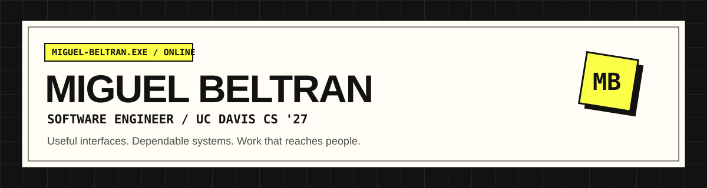

[Portfolio](https://migueljbeltran.github.io/) · [Resume](https://migueljbeltran.github.io/Assets/Resume/Miguel_Beltran_Resume.pdf) · [LinkedIn](https://www.linkedin.com/in/miguel-j-beltran/) · [Email](mailto:migueljoaquinbeltran@gmail.com)

I build software people rely on: university advising systems, event tools, and game analytics. I enjoy the work between a clear interface and a dependable backend, especially when it involves untangling data flows and testing the paths that matter.

I'm studying **Computer Science at UC Davis**, graduating in **June 2027**. Currently, I'm a **Junior Application Developer at UC Davis IET**. Previously, I was **Assistant Technical Director for ASUCD Picnic Day**.

### Current work & recent experience

- **UC Davis IET** — C#/.NET advising applications and OASIS-uAchieve integrations supporting a university population of **31,000+ undergraduates**. My work includes student-form processing, academic-credit calculations, release verification, degree-audit code review, and documentation for a ServiceNow migration.
- **Picnic Day · Nov 2025 – May 2026** — Designed and developed the React/TypeScript Schedule Builder for an event with **70,000+ attendees**, including onboarding, interactive maps, calendar exports, SQLite data workflows, authenticated Google Sheets sync, and Docker Compose setup.
- **dltracker** — a deployed Deadlock analytics platform used by **1,000+ users**, with player profiles, regional leaderboards, caching, and automated release checks.

### Selected builds

| Project | What I built | Stack |
| :--- | :--- | :--- |
| **[dltracker](https://github.com/migueljbeltran/deadlock-tracker)** · [live](https://dltracker.app/) | Steam and Deadlock API integration, player identity resolution across 5 regional leaderboards, Redis caching, rate limiting, and outage fallbacks. | TypeScript, Next.js, Redis, Playwright, Vitest |
| **[Picnic Day Schedule Builder](https://github.com/ucdavis/ASUCD-PicnicDay-Scheduler)** | Event discovery, onboarding, maps, calendar exports, and synchronized event data for UC Davis Picnic Day. | React, TypeScript, SQLite, Docker |
| **[Spotify Hit Classifier](https://github.com/Rytham1/song-popularity-predictor)** | Feature engineering and model tuning over **32,000+ tracks**, achieving **80% Random Forest accuracy**. | Python, TensorFlow, XGBoost, scikit-learn |
| **[Kitch](https://github.com/migueljbeltran/Kitch)** | Kitchen inventory, shopping lists, and recipes, with a layered backend and **20+ REST endpoints**. | Java, Spring Boot, React, JPA, H2 |
| **[8-Bit CPU](https://github.com/migueljbeltran/8bit-cpu)** | A 5-stage pipelined processor with forwarding, hazard detection, and 20+ custom ISA instructions. | Logisim, digital logic |

### Toolkit

| Area | Technologies |
| :--- | :--- |
| **Languages** | TypeScript, JavaScript, Python, Java, C#, C, C++, Go, SQL |
| **Interfaces** | React, Next.js, Tailwind CSS, SCSS, HTML/CSS |
| **Applications** | .NET Framework, ASP.NET Web Forms, Node.js, Express, Spring Boot, Flask, FastAPI, REST APIs |
| **Data** | Prisma, PostgreSQL, SQLite, Redis, Firestore, Supabase |
| **Delivery & quality** | AWS, Docker, GitHub Actions, CI/CD, Linux, Vercel, Sentry, ServiceNow, Playwright, Vitest, Pytest |
| **Machine learning** | TensorFlow, PyTorch, XGBoost, scikit-learn, Pandas, NumPy |

### Experience

| Role | Team | Dates |
| :--- | :--- | :--- |
| **Junior Application Developer** | UC Davis Information & Educational Technology | Jun 2026 – Present |
| **Assistant Technical Director** | ASUCD Picnic Day | Nov 2025 – May 2026 |
| **Software Engineer** | #include Davis | Oct 2025 – Apr 2026 |
| **Software Engineer** | Google Developer Student Clubs | Oct 2024 – Jun 2025 |

At **#include Davis**, I delivered responsive React/Next.js features for the Space and Satellite Systems client website from Figma designs. At **GDSC**, I built a Python/Flask Slack bot for onboarding and scheduled announcements, saving organizers **2+ hours per week**.

---

Based in **Davis, California**. Open to software engineering internships and full-stack opportunities.

**[Let's talk →](mailto:migueljoaquinbeltran@gmail.com)**
