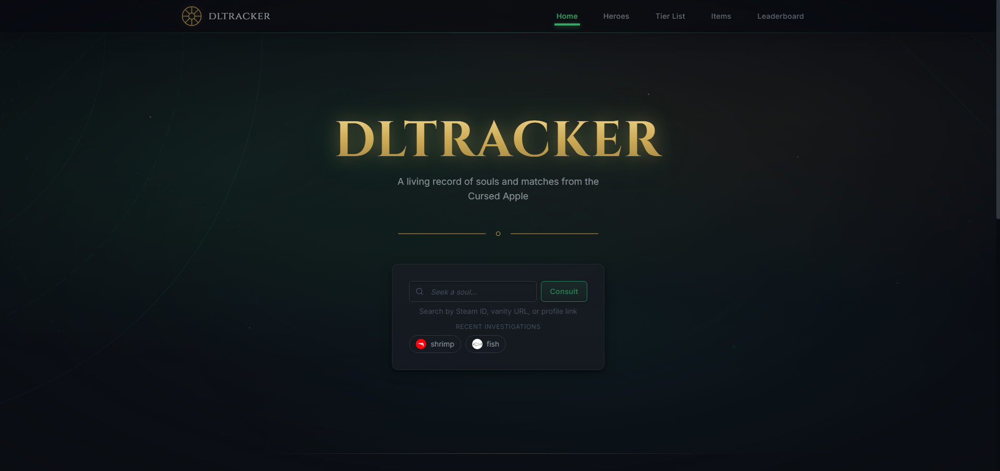
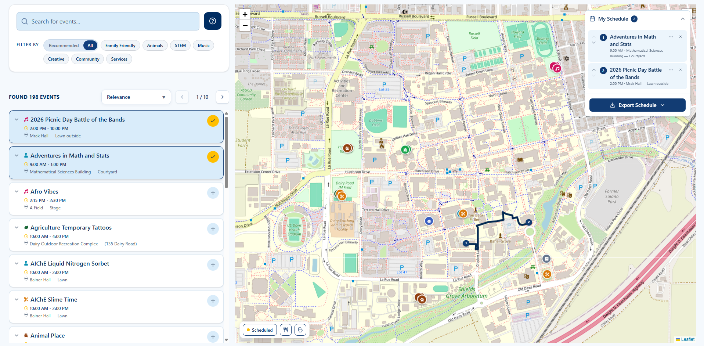
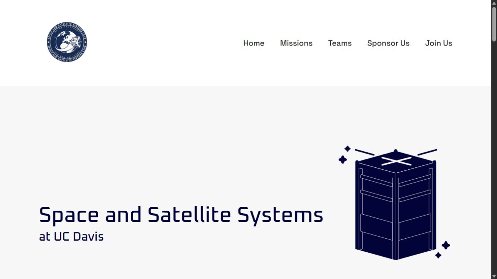
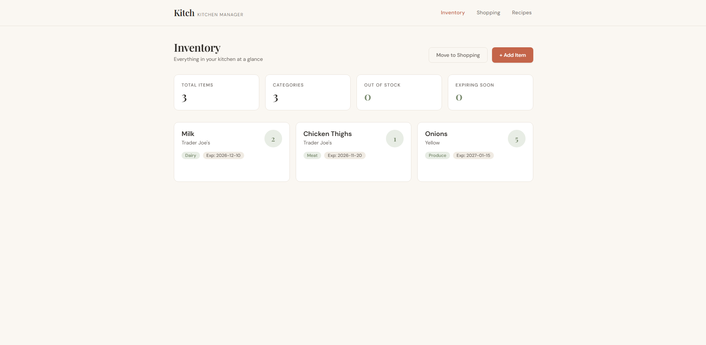

  
  
  

I'm **Miguel**, a **UC Davis Computer Science student graduating in June 2027** and **Junior Application Developer at UC Davis IET**. I build across the stack, from C#/.NET advising systems to event tools and game analytics.

I like making complicated things feel straightforward—and building around things I care about.

### Selected builds

<table>
  <tr>
    <td width="50%" valign="top">
      
      <h3>dltracker</h3>
      
<strong>Game analytics · 1,000+ users</strong>

      
Built player profiles, identity resolution across five regional leaderboards, Redis caching, and release checks.

      
Next.js · TypeScript · Redis · Playwright

      
 

    </td>
    <td width="50%" valign="top">
      
      <h3>Picnic Day Schedule Builder</h3>
      
<strong>Event tools · UC Davis</strong>

      
Designed and developed the Schedule Builder for an event with 70,000+ attendees: maps, exports, and synchronized event data.

      
React · TypeScript · SQLite · Docker

      
 

    </td>
  </tr>
  <tr>
    <td width="50%" valign="top">
      
      <h3>Space &amp; Satellite Systems</h3>
      
<strong>Client work · #include Davis</strong>

      
Delivered responsive website features from Figma designs, with reusable components for desktop and mobile.

      
React · Next.js · SCSS

      
 

    </td>
    <td width="50%" valign="top">
      
      <h3>Kitch</h3>
      
<strong>Full-stack kitchen management</strong>

      
Built inventory, shopping-list, and recipe features around a layered Spring Boot backend with 20+ REST endpoints.

      
Java · Spring Boot · React · JPA

      

    </td>
  </tr>
</table>

<strong>More side quests: machine learning &amp; computer architecture</strong>

- **[Spotify Hit Classifier](https://github.com/Rytham1/song-popularity-predictor)** — engineered features and tuned models over 32,000+ tracks, achieving 80% Random Forest accuracy. Python, TensorFlow, XGBoost, scikit-learn.
- **[8-Bit CPU](https://github.com/migueljbeltran/8bit-cpu)** — a 5-stage pipelined processor with forwarding, hazard detection, and 20+ custom ISA instructions in Logisim.

### Where I've been building

- **UC Davis IET · Junior Application Developer** — Jun 2026–Present 
  C#/.NET advising systems and OASIS-uAchieve integrations supporting UC Davis's 31,000+ undergraduate population; student-form processing and release verification.
- **ASUCD Picnic Day · Assistant Technical Director** — Nov 2025–May 2026 
  Schedule Builder, interactive maps, calendar exports, SQLite/Google Sheets sync, and Docker Compose setup.
- **#include Davis · Software Engineer** — Oct 2025–Apr 2026 
  Responsive React/Next.js client features for Space and Satellite Systems.
- **Google Developer Student Clubs · Software Engineer** — Oct 2024–Jun 2025 
  Python/Flask Slack bot for onboarding and scheduled announcements, saving organizers 2+ hours per week.

### My toolkit

**Interfaces**

**Backend & APIs**

**Data & persistence**

**Testing & delivery**

**Machine learning**

<strong>Open the full toolbox</strong>

<table>
  <tr>
    <td><strong>Languages</strong></td>
    <td>
      
      
      
      
      
      
      
      
      
    </td>
  </tr>
  <tr>
    <td><strong>Frontend</strong></td>
    <td>
      
      
      
      
      
      
    </td>
  </tr>
  <tr>
    <td><strong>Backend</strong></td>
    <td>
      
      
      
      
      
      
      
      
    </td>
  </tr>
  <tr>
    <td><strong>Data</strong></td>
    <td>
      
      
      
      
      
      
    </td>
  </tr>
  <tr>
    <td><strong>Testing & DevOps</strong></td>
    <td>
      
      
      
      
      
      
      
      
      
      
      
    </td>
  </tr>
  <tr>
    <td><strong>Machine learning</strong></td>
    <td>
      
      
      
      
      
      
    </td>
  </tr>
</table>

---

**Away from the keyboard:** games, cooking for people, food crawls, anime, and learning electric guitar. Usually chasing a better build—or a cleaner chord.

Based in **Davis, California**. Open to software engineering internships and full-stack opportunities.

**[Got something worth building? Let's talk. →](mailto:migueljoaquinbeltran@gmail.com)**
